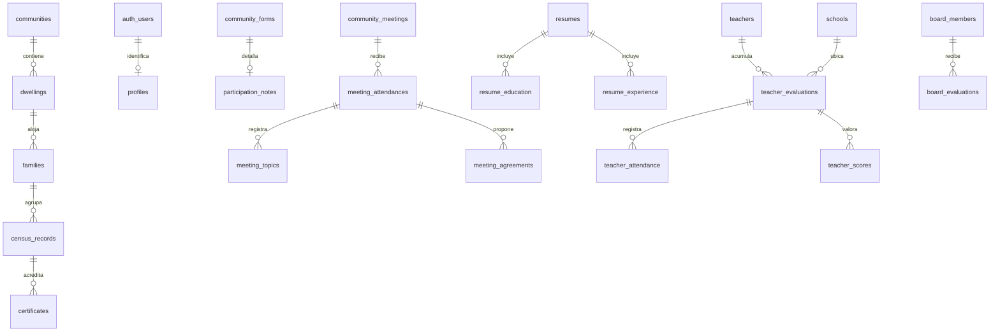

# Estructura de datos de la plataforma Guajuí

La migración `20261103160000_complete_platform.sql` amplía las tablas existentes. La entrada pública `community_forms` permanece compatible con los cinco formularios actuales y sus registros originales se conservan. Un disparador guarda los campos en tablas relacionadas dentro de la misma transacción.

## Módulos y tablas

| Sección | Tablas | Relación principal |
| --- | --- | --- |
| Territorio | communities, community_localities | 8 comunidades canónicas y localidades/códigos del censo |
| Usuarios | profiles, auth.users | Identidad en Supabase Auth; rol, comunidad y estado en profiles |
| Censo | dwellings, families, census_records | Una vivienda contiene varias familias; cada persona pertenece a una familia |
| Actualizaciones y novedades | census_requests, community_novelties | Solicitudes y hechos relacionados con personas censadas |
| Certificados | certificates | Fotografía de los datos al expedir y código UUID de verificación |
| Consejo, inicio y páginas | site_pages | Secciones públicas editables, almacenadas como bloques JSON |
| Grupos y chirimías | community_groups | Tipo de grupo, comunidad y descripción pública |
| Noticias y publicaciones | content_items | Autor, estado de revisión, comunidad y grupo |
| Proyectos | projects | Fechas, objetivo, progreso y estado relacionados con una publicación |
| Agenda | agenda_events | Fecha, hora y lugar relacionados con una publicación |
| El Churo | churo_editions | Número de edición, fecha y archivo |
| Encuestas editables | surveys, survey_responses | Preguntas JSON versionadas con el formulario y sus respuestas |
| Apuntes | participation_notes | Comunidad, persona, fecha, hechos y solución |
| Reuniones | community_meetings, meeting_attendances, meeting_topics, meeting_agreements | Reunión creada por admin; temas y acuerdos de cada asistente |
| Hojas de vida | resumes, resume_education, resume_experience | Datos personales, varios estudios y varios empleos |
| Junta | board_positions, board_members, board_evaluations | Cargo, integrante y evaluaciones de 1 a 5 |
| Docentes | teachers, teacher_aliases, schools, teacher_evaluations | Identidad estable, sede y períodos de seguimiento |
| Asistencia y calificaciones | teacher_attendance, teacher_criteria, teacher_scores | Asistencia diaria separada de las seis valoraciones |
| Contacto | contact_requests | Mensaje completo y estado de atención |
| Archivos | media_assets, storage.buckets, storage.objects | Metadatos y archivos públicos/privados |
| Control | audit_log, migration_issues, app_schema_versions | Autoría de cambios, registros por revisar y versión instalada |

Los campos extensos del censo se conservan en `census_records.answers`, para no perder preguntas y valores antiguos. Comunidad, vivienda y familia tienen relaciones e índices; las respuestas sensibles no tienen lectura pública. La edad se calcula a partir de la fecha de nacimiento en la aplicación.

## Relaciones principales



## Permisos efectivos en la base

La migraci?n posterior `20261103190000_three_roles.sql` limita el sistema a **superadministrador**, **encuestador** y **responsable comunitario**. Reemplaza las pol?ticas de los perfiles retirados y usa identidades autorizadas vinculadas a usuarios de ingreso. Consulta [ACCESS.md](./ACCESS.md) para la matriz de funciones.

Las tablas derivadas de formularios solo admiten lectura administrativa directa; sus cambios se guardan mediante `community_forms` en la misma transacci?n. Las vistas usan `security_invoker` y las funciones auxiliares privadas no son invocables por el cliente.

## Reglas verificadas

- Códigos de vivienda únicos dentro de la comunidad; códigos de familia únicos dentro de la vivienda.
- Los alias del censo, incluyendo Joanico/Junico, Quiroga 1/2 y los códigos de localidades, se resuelven a las comunidades canónicas.
- Las solicitudes de censo tienen un ámbito derivado de sus datos; un líder no puede falsificar la comunidad para cambiar otra.
- `decide_census_request` aprueba y actualiza la persona en una transacción, con bloqueo de la solicitud para evitar decisiones dobles.
- El certificado toma nombre, documento enmascarado y comunidad del censo. La consulta pública por UUID devuelve solo esos campos y la validez.
- Una evaluación docente cubre todas las fechas del período, hasta 62 fechas; los días pendientes no se cuentan como ausencias.
- La exclusión GiST impide períodos superpuestos para el mismo docente y sede, incluso frente a escrituras simultáneas.
- N/O se almacena como calificación nula y se excluye del promedio.
- La verificación exige completar las jornadas programadas.
- Las vistas mensuales/anuales ordenan por promedio y, en empate, menos días de ausencia. Si ambos valores coinciden, comparten puesto.
- Una evaluación que abarca dos meses cuenta en ambos informes mensuales y una sola vez en el anual. Los días se recortan al período del informe.
- Si un docente aparece en varias sedes el mismo día, el resumen usa una sola fecha: ausencia prevalece sobre parcial, y completa requiere todas las jornadas completas. Los registros por sede permanecen disponibles.
- Las reejecuciones conservan originales; los registros antiguos incompatibles aparecen en `migration_issues`. Corregir y guardar el formulario vuelve a generar sus detalles.

Los nombres normalizados ayudan a reunir registros de la misma persona dentro de su comunidad. No resuelven por sí solos homónimos, errores ortográficos ni traslados entre comunidades. Esos casos requieren una futura pantalla para confirmar o fusionar identidades. Los períodos conocidos de integrantes de junta se pueden registrar en `board_members`; el formulario actual crea identidades provisionales por nombre y cargo.

## Instalación

En la terminal de VS Code dentro de `D:\W\guajui`:

```powershell
npm run db:apply
```

Pega la cadena de **Connect → Session pooler**, manteniendo `[YOUR-PASSWORD]`. Introduce la contraseña de la base cuando el programa la solicite de forma oculta. El instalador valida el proyecto, usa una transacción, comprueba tablas con RLS antes de confirmar y registra la versión. Si encuentra un error, revierte la instalación.

Para ensayar sin confirmar cambios:

```powershell
npm run db:apply -- --dry-run
```

Si el esquema ya está instalado, el comando comprueba su presencia y no lo vuelve a aplicar. Los cambios futuros deben ir en una nueva migración. No volver a ejecutar los SQL antiguos de forma aislada: contienen funciones y permisos que esta ampliación sustituye.

Consulta de registros que requieren revisión, desde una sesión administrativa:

```sql
select source_table, source_id, reason
from public.migration_issues
order by recorded_at desc;
```

## Integración pendiente

Esta entrega amplía y prueba la estructura; no cambia automáticamente todos los almacenamientos de la página:

1. Apuntes, reuniones, hojas de vida, docentes y junta ya escriben en `community_forms`. Tras instalar la ampliación, sus tablas de detalle se alimentarán automáticamente.
2. Censo, usuarios locales, encuestas editables, contenido, contacto y certificados todavía requieren adaptar sus pantallas a las nuevas tablas y funciones.
3. Para migrar el censo hay que importar registros locales con identidad administrativa, revisar duplicados y retirar `src/data/censusSeed.js` del paquete público cuando la consulta remota esté lista.
4. La administración local con usuario/contraseña debe sustituirse por Supabase Auth para los módulos migrados. El acceso a formularios privados ya consulta el rol mediante `is_guajui_owner`.
5. Los archivos actuales y las entradas de localStorage no se suben automáticamente. Se requiere una importación explícita, con resultados y revisión por el administrador.

Las ocho comunidades canónicas coinciden con el catálogo actual del formulario. La página “Consejo” todavía muestra una cifra de doce; hace falta confirmar si esa cifra incluye localidades antes de cambiar el catálogo.

## Pruebas

`npm run test:database` ejecuta el SQL real en PostgreSQL mediante PGlite, con usuarios y roles de prueba. Comprueba instalación nueva, actualización desde migraciones anteriores, repetición, acceso anónimo, límites por comunidad, imposibilidad de escalar roles, cuatro familias en una vivienda, proyecciones de formularios, asistencia, N/O, desempate, solicitudes, certificados y archivos privados.

PGlite simula el esquema Auth y Storage; no prueba el envío de correos, la red del proyecto ni una sesión real de Supabase. La instalación remota debe hacerse con la contraseña en la terminal del propietario.## Integraci?n de las pantallas

Las pantallas de censo, solicitudes, encuestas editables, publicaciones, agenda, contacto, certificados, p?ginas, grupos y archivos usan Supabase. Los formularios de apuntes, reuniones, hojas de vida, docentes y junta siguen usando la entrada compatible `community_forms`, que alimenta sus tablas relacionadas.

El panel usa exclusivamente Supabase Auth con usuario y contrase?a. La migraci?n `20261104120000_username_password.sql` a?ade `access_grants.login_username`, ?nico, y la configuraci?n de identidades restringida al servicio del servidor. No hay usuarios locales ni importaci?n autom?tica de localStorage. El censo de ejemplo queda fuera del paquete p?blico. Los datos que ya estaban en Supabase se conservan.

La nueva migraci?n a?ade `access_grants` para autorizar correos, `event_registrations` para inscripciones y funciones transaccionales para publicaciones y lotes censales. Se guardan preguntas de referencia en cada respuesta de encuesta.

La actualizaci?n debe instalarse con `npm run db:apply` antes de utilizar el nuevo panel. Los accesos del correo inicial y del personal se explican en [CONNECT.md](./CONNECT.md).

## Pruebas

`npm run test:database` ejecuta el SQL real en PostgreSQL mediante PGlite, con usuarios y roles de prueba. Comprueba instalación nueva, actualización desde migraciones anteriores, repetición, acceso anónimo, límites por comunidad, imposibilidad de escalar roles, cuatro familias en una vivienda, proyecciones de formularios, asistencia, N/O, desempate, solicitudes, certificados y archivos privados.

PGlite simula el esquema Auth y Storage; no prueba el envío de correos, la red del proyecto ni una sesión real de Supabase. La instalación remota debe hacerse con la contraseña en la terminal del propietario.
